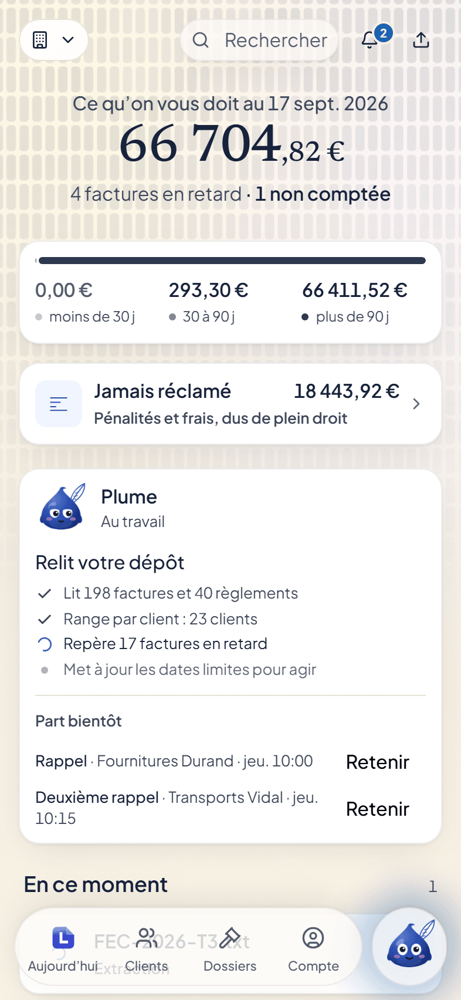
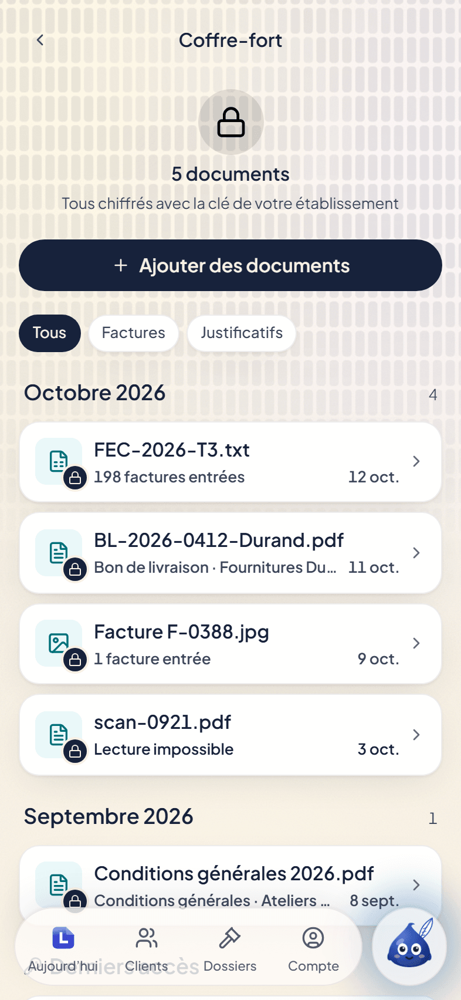
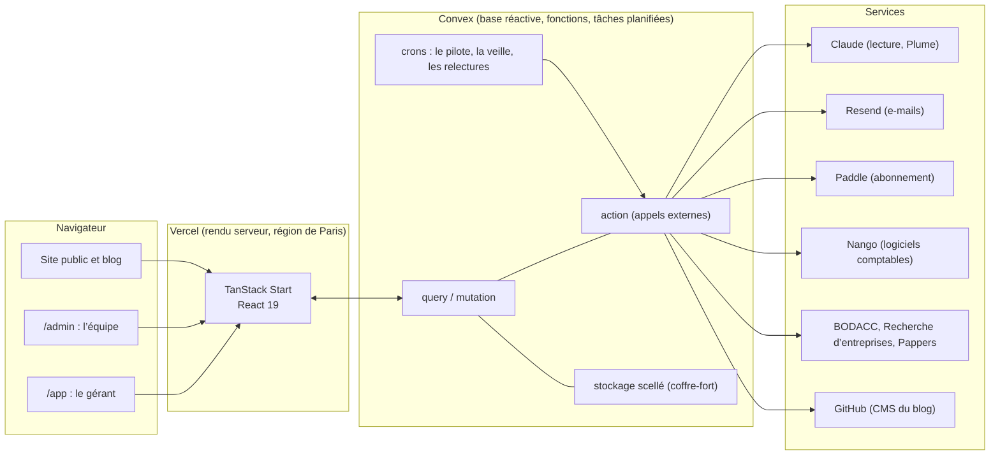

<div align="center">


# Letikette

**Le logiciel de recouvrement de créances B2B.**

Letikette lit les factures d’une entreprise, calcule ce que chaque client lui doit, pénalités
et frais compris, surveille la date limite pour agir en justice, et relance à son nom.

[letikette.com](https://www.letikette.com) · [Tarifs](https://www.letikette.com/tarifs) ·
[Sécurité](https://www.letikette.com/securite) · [Blog](https://www.letikette.com/blog)

[](LICENSE)
[](https://www.typescriptlang.org/)
[](https://react.dev/)
[](https://tanstack.com/start)
[](https://convex.dev/)
[](https://vercel.com/)

<br />


&nbsp;&nbsp;

&nbsp;&nbsp;


</div>

---

## Sommaire

- [Le produit](#le-produit)
- [Les trois lignes rouges](#les-trois-lignes-rouges)
- [Architecture](#architecture)
- [Pile technique](#pile-technique)
- [Structure du dépôt](#structure-du-dépôt)
- [Démarrer en local](#démarrer-en-local)
- [Variables d’environnement](#variables-denvironnement)
- [Scripts](#scripts)
- [Qualité et barrières](#qualité-et-barrières)
- [Règles du projet](#règles-du-projet)
- [Sécurité](#sécurité)
- [Déploiement](#déploiement)
- [Documentation](#documentation)
- [Licence](#licence)

---

## Le produit

Une facture impayée ne fait aucun bruit le jour où elle devient irrécouvrable. Trois choses sont
dues de plein droit à une entreprise payée en retard, et presque jamais réclamées faute de savoir
les calculer : les **pénalités de retard**, les **frais de recouvrement forfaitaires** par
facture, et le respect de la **date limite pour agir en justice**, qui varie selon le secteur.

Letikette est un abonnement qui **mesure**, **documente** et **alerte**. Le logiciel lit, calcule
et montre ; le dirigeant qualifie, choisit et signe.

| Ce que fait Letikette            | Comment                                                                                                                                                                                                                               |
| -------------------------------- | ------------------------------------------------------------------------------------------------------------------------------------------------------------------------------------------------------------------------------------- |
| **Importer les factures**        | Dépôt de fichiers et de photos, export comptable, ou connexion au logiciel du gérant (Pennylane, QuickBooks, Xero, Sellsy, Stripe, Zoho) et à sa banque. La lecture est automatique, le rapprochement des paiements aussi.            |
| **Calculer ce qui est dû**       | Un décompte au centime, daté le jour où il se réclame, décomposé période par période : principal, taux, nombre de jours, base annuelle. Il se refait à la main.                                                                       |
| **Surveiller les délais**        | Échéances, date limite pour agir en justice selon le secteur (transport, commande publique, particuliers), procédures collectives publiées au BODACC.                                                                                 |
| **Relancer**                     | Plume, le pilote des relances, prépare et envoie les rappels puis la lettre officielle au nom du gérant, une fois qu’il l’a activé. Chaque envoi s’affiche une heure avant de partir et se retient d’un geste ; un paiement l’arrête. |
| **Encaisser sans intermédiaire** | Une page de paiement au nom du créancier : son IBAN, le montant, la référence, un QR de virement européen. Le client paie depuis sa propre banque.                                                                                    |
| **Ranger les preuves**           | Un coffre-fort : chaque document est scellé à son arrivée, chiffré sous une clé propre à l’établissement, et chaque accès est journalisé.                                                                                             |
| **Connaître ses clients**        | La santé de chaque client : un indice expliqué fait par fait, ses dirigeants, ses comptes publiés, ses antécédents.                                                                                                                   |
| **Passer la main**               | Quand une procédure s’impose, le dossier se transmet à l’avocat ou au commissaire de justice que le gérant choisit, trouvés près de son client.                                                                                       |

Le produit se présente **téléphone d’abord**, comme une application iOS, avec une coquille de
bureau au-delà de 1024 px. L’interface est entièrement en français : le droit applicable est
le droit français.

À côté de l’application vivent le **site public** (tarifs, pages par métier, calculateur des
pénalités, blog) et l’**interface d’administration** de l’équipe : CRM et prospection, service
client, journal, et le CMS du blog (un éditeur à blocs qui publie sur GitHub).

## Les trois lignes rouges

Elles sont tenues par des tests, pas par des intentions.

1. **Les relances partent seules quand le gérant l’a décidé ; rien ne part vers un tribunal.**
   Tout part au seul nom du gérant. Ce qui relève d’un tribunal passe par l’avocat qu’il choisit.
   Letikette ne remplace aucun métier réglementé.
2. **Aucun fonds ne transite par Letikette.** Ni encaissement, ni séquestre, ni commission sur
   ce qui rentre. La page de paiement transmet une information ; le client paie sa dette dans sa
   banque.
3. **Le produit montre ce que dit la loi, ce que contient le dossier et ce que le gérant a
   répondu.** Il ne dit jamais qu’une condition est remplie, ni qu’il faudrait engager une
   procédure.

Les trois surfaces qui partent vers un tiers (le corps d’un courrier, le décompte en PDF, la page
de paiement) ne nomment pas le logiciel et ne font remonter aucune donnée du débiteur.

## Architecture



Le code se lit en trois zones, et **la frontière est un test**
(`src/lib/socle/__tests__/frontiere.test.ts`) :

| Zone                               | Rôle                                                                                                                                                                         |
| ---------------------------------- | ---------------------------------------------------------------------------------------------------------------------------------------------------------------------------- |
| `src/lib/socle/`                   | Le moteur : ingestion multi-format, extraction ligne à ligne, normalisation, dédoublonnage, rapprochement, coût des appels au modèle. **Il ne sait pas quelle loi il sert.** |
| `src/lib/verticales/recouvrement/` | Le domaine : le registre des valeurs juridiques, les calculs (décompte, délais, prescription), le plan de relance, l’analyse du risque, les gabarits de courriers.           |
| `src/lib/convex/`                  | Les `query`, `mutation` et `action` Convex, et rien d’autre. La logique pure vit hors de ce dossier, testable sans plateforme.                                               |

Le socle n’importe jamais une verticale ni Convex ; l’inverse est libre.

## Pile technique

| Couche                    | Technologie                                                                             |
| ------------------------- | --------------------------------------------------------------------------------------- |
| Langage                   | TypeScript 6, strict, sans `any`                                                        |
| Interface                 | React 19, compilateur React, TanStack Router et TanStack Start (Vite 8)                 |
| Système visuel            | Tailwind CSS 4 et le kit Cladd (`@cladd-ui/react`, version épinglée)                    |
| Base et fonctions         | Convex 1.37 : requêtes réactives, mutations transactionnelles, actions, crons, stockage |
| Authentification          | Better Auth, installé dans Convex ; double authentification pour l’équipe               |
| Intelligence artificielle | Claude (API Anthropic), appelé depuis des actions Convex                                |
| Paiement de l’abonnement  | Paddle, revendeur officiel (Merchant of Record)                                         |
| E-mails                   | Resend                                                                                  |
| Connexions                | Nango (logiciels comptables), Qonto (banque), Uppy et Companion (services de fichiers)  |
| Éditeur du blog           | BlockNote, sur un MDX compilé par content-collections                                   |
| Tests                     | Vitest (unitaires), Playwright (bout en bout)                                           |
| Gestionnaire de paquets   | Bun 1.3                                                                                 |
| Déploiement               | Vercel (frontal) et Convex (fonctions et données)                                       |

## Structure du dépôt

```text
.
├── content/blog/            Les articles du blog, en MDX, et leur charte (README.md)
├── docs/
│   ├── blueprint/           La direction du projet : manifeste, frontière du MVP, feuille de route
│   ├── juridique/           Les textes publiés : mentions légales, CGV, confidentialité, sous-traitance
│   └── superpowers/specs/   Les spécifications de chaque chantier, datées
├── e2e/                     Les parcours Playwright
├── public/                  Icônes, photos, captures du produit (`ecrans/`)
├── scripts/                 Développement, déploiement, captures d’écran, aperçu des e-mails
├── serveurs/                Les services annexes et leur mise en route (Companion, Nango, Paddle)
└── src/
    ├── routes/              Les routes TanStack (fichiers) : site, /app, /admin, /p/<jeton>
    ├── screens/             Les écrans, composés des pièces du kit
    ├── ui/                  Le kit d’interface : la SEULE zone où s’écrivent des classes Tailwind
    ├── app/                 Le câblage : données, préchargement, coquilles, hooks
    ├── marketing/           Le site public et les composants des articles
    ├── styles/              Les jetons de design (échelle, couleurs, typographie)
    └── lib/
        ├── socle/           Le moteur, indépendant du droit
        ├── verticales/      Le recouvrement : registre, calculs, relances, risque
        ├── convex/          Le backend Convex (schéma, fonctions, crons, webhooks)
        ├── blog/            Le CMS : en-tête, MDX ⇄ blocs, catalogue, publication GitHub
        ├── admin/ crm/      L’interface d’administration et la prospection
        ├── croissance/      Les étapes, le score et les conseils du moteur de croissance
        └── support/         Le service client : passage à l’équipe, masquage, base d’aide
```

| Espace             | Adresse                                                                                     | Public                                                                   |
| ------------------ | ------------------------------------------------------------------------------------------- | ------------------------------------------------------------------------ |
| Site public        | `/`, `/tarifs`, `/securite`, `/secteurs/<métier>`, `/blog`, `/taux-des-penalites-de-retard` | Tout le monde                                                            |
| Application        | `/app/*`                                                                                    | Le gérant et son équipe (`ORG_ADMIN`, `ORG_MEMBER`)                      |
| Page de paiement   | `/p/<jeton>`                                                                                | Le client du gérant, sans compte                                         |
| Administration     | `/admin/*`                                                                                  | L’équipe Letikette (`FONDATEUR`, `SUPPORT`, `LECTURE`)                   |
| Salle d’exposition | `/showroom`                                                                                 | Développement seulement : chaque écran avec des données de démonstration |

## Démarrer en local

### Prérequis

- [Bun](https://bun.sh) 1.3.9 (version fixée dans `package.json`)
- Un compte [Convex](https://convex.dev) et un déploiement de développement
- Les accès aux services dont on veut voir les fonctions (voir plus bas : sans clé, chaque
  fonction concernée reste en sommeil et le dit à l’écran)

### Installation

```bash
bun install
```

Les variables se déclarent dans `.env.schema` (frontal) et `.env-convex.schema` (Convex), lues et
typées par [varlock](https://varlock.dev). Les valeurs vont dans `.env.local`, qui n’est jamais
versionné.

```bash
npx convex dev --once
```

La première exécution relie le dossier à un déploiement Convex et pousse le schéma et les
fonctions. Les variables côté Convex se posent ensuite avec `npx convex env set NOM valeur`.

### Lancer

```bash
bun run dev:cloud
```

Le frontal sert sur `http://localhost:20173`, branché au déploiement Convex de développement, et
recharge à chaque modification. Le port est fixe : l’authentification en dérive son origine de
confiance.

Pour travailler sur l’interface sans backend ni compte, la salle d’exposition suffit :

```bash
bun run dev:frontend
```

puis `http://localhost:20173/showroom`.

### Premier compte de l’équipe

```bash
npx convex run admin/equipe:amorcer '{"email":"vous@exemple.fr"}'
```

Le premier fondateur s’amorce en ligne de commande ; les suivants s’invitent depuis `/admin`.

## Variables d’environnement

Aucune valeur ne s’écrit dans le dépôt. Une fonction dont la clé manque reste **en sommeil** et le
dit, au lieu d’échouer en silence.

**Frontal** (`.env.local`)

| Variable                                                           | Rôle                                                                  |
| ------------------------------------------------------------------ | --------------------------------------------------------------------- |
| `CONVEX_DEPLOYMENT`, `PUBLIC_CONVEX_URL`, `PUBLIC_CONVEX_SITE_URL` | Le déploiement Convex                                                 |
| `VITE_COMPANION_URL`, `VITE_GOOGLE_PICKER_*`                       | Facultatives : l’import depuis Google Drive, Dropbox, OneDrive et Box |

**Convex** (`npx convex env set`)

| Variable                                                               | Rôle                                                          | Sans elle                                                                                                         |
| ---------------------------------------------------------------------- | ------------------------------------------------------------- | ----------------------------------------------------------------------------------------------------------------- |
| `BETTER_AUTH_SECRET`, `SITE_URL`                                       | Sessions et adresses                                          | Requises                                                                                                          |
| `RESEND_API_KEY`, `AUTH_EMAIL`                                         | E-mails du compte                                             | Requises                                                                                                          |
| `ANTHROPIC_API_KEY`                                                    | Lecture des documents, Plume                                  | Requise                                                                                                           |
| `COFFRE_CLE_MAITRESSE`                                                 | Clé qui enveloppe les clés du coffre-fort                     | Les documents ne se scellent pas. **À sauvegarder hors de Convex** : la perdre rend tous les documents illisibles |
| `RELANCES_EMAIL`                                                       | Adresse d’envoi des relances                                  | Reprend `AUTH_EMAIL`                                                                                              |
| `PADDLE_API_KEY`, `PADDLE_CLIENT_TOKEN`, `PADDLE_WEBHOOK_SECRET`       | Abonnement                                                    | Pas de paiement                                                                                                   |
| `PADDLE_FACTURATION_OUVERTE`                                           | Ouvre la facturation (`oui`)                                  | Abonnement fermé                                                                                                  |
| `NANGO_SECRET_KEY`, `NANGO_WEBHOOK_SIGNING_KEY`                        | Logiciels comptables                                          | Connexions en sommeil                                                                                             |
| `QONTO_CLIENT_ID`, `QONTO_CLIENT_SECRET`, `CONNEXIONS_CLE_CHIFFREMENT` | Banque                                                        | Connexion bancaire en sommeil                                                                                     |
| `PAPPERS_API_KEY`                                                      | Santé des clients                                             | Analyse du risque en sommeil                                                                                      |
| `GITHUB_CMS_TOKEN`                                                     | CMS du blog (jeton à portée fine, contenu du dépôt seulement) | Le CMS dit ce qu’il faut poser                                                                                    |
| `PLUME_SUPPORT_OUVERT`                                                 | Assistant du service client (`oui`)                           | Le support passe directement à l’équipe                                                                           |
| `UMAMI_API_KEY`, `FONDATEUR_EMAIL`                                     | Point chiffré du lundi                                        | Point sans trafic                                                                                                 |

La liste complète, commentée variable par variable, est dans les deux fichiers de schéma.

## Scripts

| Commande               | Effet                                                            |
| ---------------------- | ---------------------------------------------------------------- |
| `bun run dev:cloud`    | Frontal et fonctions, sur un déploiement Convex de développement |
| `bun run dev:frontend` | Frontal seul (salle d’exposition)                                |
| `bun run check`        | Vérification des types, application puis Convex                  |
| `bun run lint`         | ESLint et oxlint, dont la muselière du système visuel            |
| `bun run test`         | Tests unitaires (Vitest)                                         |
| `bun run test:e2e`     | Parcours de bout en bout (Playwright)                            |
| `bun run build`        | Construction de production                                       |
| `bun run check:bundle` | Vérifie que les fonctions Convex s’empaquettent                  |
| `bun run knip`         | Code et dépendances inutilisés                                   |

## Qualité et barrières

Plus de **2 100 tests unitaires** couvrent le moteur, le domaine, les fonctions Convex et les
règles d’interface. Une partie d’entre eux ne vérifie pas un comportement mais **une règle du
projet**, pour qu’elle ne dérive pas :

| Barrière                                         | Ce qu’elle refuse                                                                                                                 |
| ------------------------------------------------ | --------------------------------------------------------------------------------------------------------------------------------- |
| `frontiere.test.ts`                              | Un fichier du socle qui importe une verticale ou Convex                                                                           |
| `aucun-verdict.test.ts`, `lexique.test.ts`       | Un écran qui tranche à la place du gérant, un mot du droit là où le mot de tous les jours est attendu, toute promesse de résultat |
| `admin-tables.test.ts`, `support-tables.test.ts` | L’équipe ou le support qui lirait le contenu d’un dossier                                                                         |
| `recherche-cloisonnee.test.ts`                   | Une table sans `organizationId` qui ne serait pas exemptée nommément                                                              |
| `fonctions-appelees.test.ts`                     | Une fonction Convex publique que rien n’appelle                                                                                   |
| `donnees-vivantes.test.ts`                       | Une requête qui contourne le cache des données                                                                                    |
| `plancher-tactile.test.ts`, `familles.test.ts`   | Une cible tactile trop petite, une couleur de seuil prise pour décorer                                                            |
| `sources-encore-en-vigueur.test.ts`              | Une valeur juridique dont la source a cessé d’être en vigueur                                                                     |
| `blocs.test.ts`                                  | Un article du blog que l’éditeur à blocs réécrirait en perdant quoi que ce soit                                                   |

**La muselière** : hors de `src/ui/`, le lint refuse les valeurs arbitraires de Tailwind, les
couleurs littérales et les tailles de police hors de l’échelle. Un écran se compose des pièces du
kit ; il n’en réinvente aucune.

## Règles du projet

- **Aucune valeur juridique n’est écrite en dur.** Taux, délais, montants et mentions vivent dans
  le registre (`src/lib/verticales/recouvrement/parametres.ts`), chacun avec sa valeur, sa source
  citable, sa date de relevé et deux drapeaux : vérifiée sur une source publique, validée par un
  juriste. Un article de loi ne se devine jamais. Un semestre absent de la série des taux fait
  lever une erreur qui le nomme, jamais une extrapolation. La règle vaut aussi pour les articles
  du blog, qui lisent ces valeurs par des composants.
- **Tout montant réclamé se décompose** en segments : principal, taux, jours, base. Un décompte
  est daté le jour où il se réclame, et ne change plus.
- **Les montants sont des entiers de centimes** (`bigint` dans la logique, `v.int64()` dans
  Convex), du parseur à l’écran. Jamais un flottant.
- **Le doute ne profite jamais au produit** : un critère indéterminé compte comme absent.
- **Cloisonnement strict par `organizationId`**, sans exception pour les données d’un client. La
  suppression des données d’un établissement est totale.
- **Le logiciel décide, le gérant confirme** : aucun écran ne demande une saisie que le logiciel
  peut déduire.
- Commits en français, fonctions Convex en camelCase, composants en PascalCase, routes en
  kebab-case, tables au pluriel.

Les conventions détaillées, et la raison de chacune, sont dans [`CLAUDE.md`](CLAUDE.md).

## Sécurité

- **Isolation des établissements** : chaque requête vérifie l’appartenance de l’utilisateur à
  l’établissement dont elle lit les données.
- **Équipe Letikette** : des rôles distincts, une adresse vérifiée et la double authentification
  exigées par l’enveloppe de chaque fonction d’administration, et un journal des consultations.
  L’équipe ne voit jamais un débiteur, une facture, un montant ni un document.
- **Coffre-fort** : chaque fichier est vérifié dans ses octets, haché (SHA-256), puis chiffré
  (AES-256-GCM) sous une clé propre à l’établissement, elle-même chiffrée par une clé maîtresse.
  Un document ne sort que par un jeton d’une minute, à usage unique.
- **Webhooks** : signatures vérifiées (Paddle, Resend, Nango) ; l’établissement transmis à Paddle
  est scellé par HMAC.
- **Service client** : les coordonnées bancaires, numéros de carte et clés sont masqués avant tout
  stockage.
- **En-têtes HTTP** stricts (HSTS, `X-Frame-Options`, politique de permissions), posés par
  `vercel.json`.

Le rendu serveur tourne dans la région Vercel de Paris ; la base Convex est hébergée aux
États-Unis.

**Signaler une vulnérabilité** : écrire à [bonjour@letikette.com](mailto:bonjour@letikette.com),
en privé, sans ouvrir de ticket public.

## Déploiement

Une poussée sur `main` déclenche Vercel, qui déploie d’abord les fonctions et le schéma Convex,
puis construit le frontal (`scripts/deploy.ts`). Le schéma Convex est validé contre les données
existantes : retirer un champ encore présent en base fait échouer le déploiement plutôt que la
production.

Les tâches planifiées (le pilote des relances, la veille des registres, l’annuaire des avocats,
les relectures mensuelles) vivent dans `src/lib/convex/crons.ts`.

## Documentation

| Document                                                                   | Contenu                                                   |
| -------------------------------------------------------------------------- | --------------------------------------------------------- |
| [`docs/blueprint/00-MANIFESTE.md`](docs/blueprint/00-MANIFESTE.md)         | La direction du projet, d’aujourd’hui à cinq ans          |
| [`docs/blueprint/01-FRONTIERE-MVP.md`](docs/blueprint/01-FRONTIERE-MVP.md) | Ce qui est dans le produit, et ce qui n’y est pas         |
| [`docs/superpowers/specs/`](docs/superpowers/specs/)                       | Une spécification par chantier, datée                     |
| [`content/blog/README.md`](content/blog/README.md)                         | La charte éditoriale du blog et son CMS                   |
| [`serveurs/`](serveurs/)                                                   | La mise en route de Companion, Nango et Paddle            |
| [`CLAUDE.md`](CLAUDE.md)                                                   | Les conventions du dépôt et les décisions qui les fondent |

## Licence

Logiciel propriétaire. © 2026 Jules-Camille Doré, entrepreneur individuel, éditeur de Letikette.
Tous droits réservés.

Sa copie, sa modification, sa redistribution et son utilisation sont interdites sans accord
écrit. Les conditions complètes sont dans [`LICENSE`](LICENSE).
